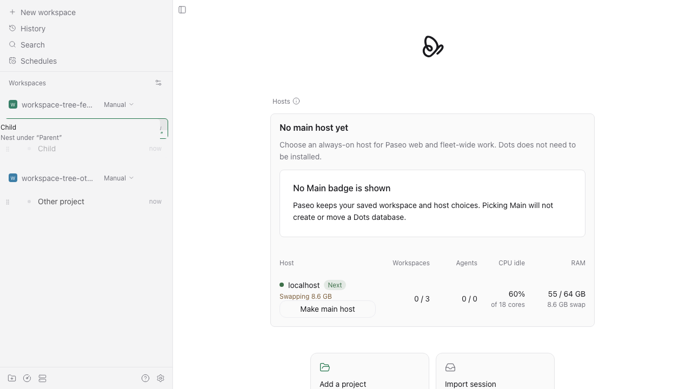
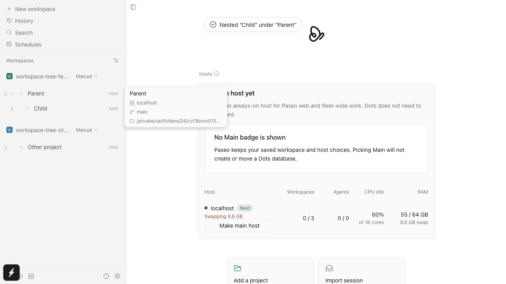
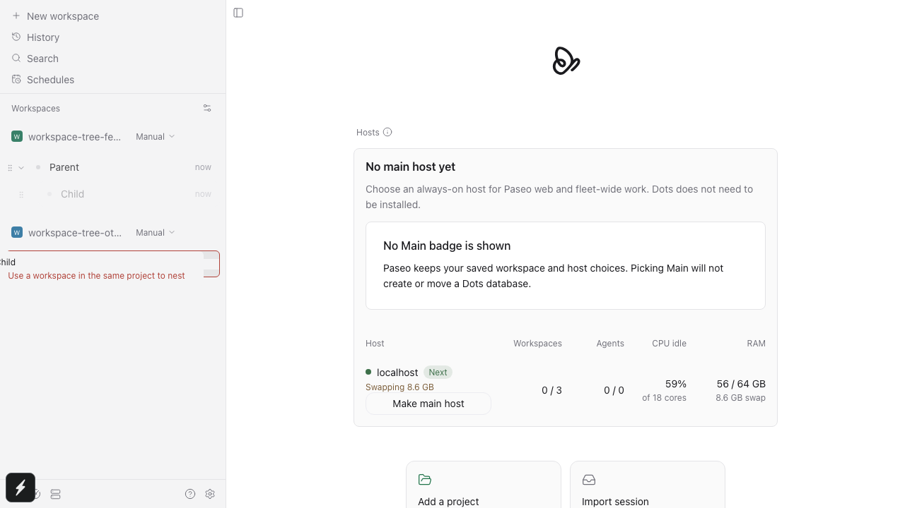

# Workspace nesting feedback: isolated QA

Source: [4660bf8d15a5061bd08213450866d58432517eea](https://github.com/tzheng11/paseo/commit/4660bf8d15a5061bd08213450866d58432517eea).

These three images use disposable Playwright fixture workspaces and an isolated daemon. They contain no production workspaces, provider logs, credentials, or user data. This orphan QA branch contains images and this README only; it changes no application source or build inputs.

The browser regression drags the whole Child row onto Parent, shows the named target inside the drag preview, holds the real move response to verify pending feedback without early success, then checks the saved parent and 16 px indentation after reload. A cross-project drop shows its full rejection reason and preserves the existing parent. A separate browser case verifies keyboard ordering, intentional nesting, and lifting out.

## Visual proof

### Named target during drag



### Confirmed saved nesting



### Blocked cross-project drop



## Executed focused checks

From `packages/app`:

```sh
npx vitest run src/components/sidebar/workspace-tree/drop-target.test.ts --project unit --bail=1
# Test Files  1 passed (1)
#      Tests  14 passed (14)

npm run test:e2e -- --grep 'workspace nesting names its target, confirms persistence, and explains blocked drops' --workers 1 --max-failures 1
# 1 passed (45.3s; case 16.8s)

npm run test:e2e -- --grep 'keyboard workspace dragging reorders, intentionally nests, and lifts out' --workers 1 --max-failures 1
# 1 passed (22.7s; case 3.7s)
```

Browser web was exercised. Native devices and macOS, Windows, and Linux desktop packages are not established by this isolated screenshot proof.
